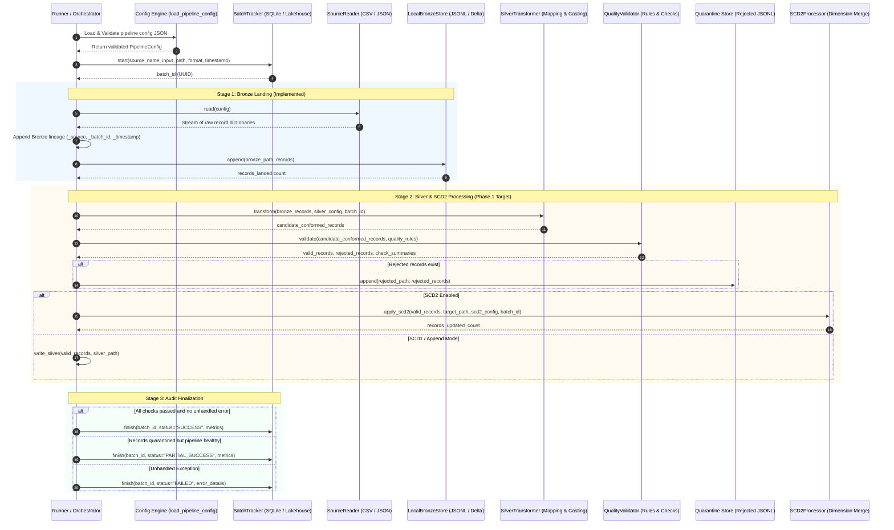

# Framework Data Flow & Execution Sequence

## 1. End-to-End Execution Sequence

---

## 2. Stage Breakdown and State Transitions

### Stage 1: Configuration Loading & Verification (Implemented)
1. Read configuration file path from CLI argument or orchestrator trigger.
2. Resolve relative filesystem paths against the configuration directory.
3. Validate base ingestion schema (`source_name`, `format`, `input_path`, `bronze_path`, `metadata_store`).
4. Validate Silver schema, data types, column mappings, and SCD2 parameters if present.
5. On failure: Abort before any batch state is initialized or files are written.

### Stage 2: Batch Initialization & Bronze Landing (Implemented)
1. Register batch in `batch_control` with status `RUNNING`, start timestamp, source name, and format.
2. Stream raw records from input source (preserving exact strings and leading zeros).
3. Decorate each record with ingestion lineage:
   - `_ingestion_source_name`
   - `_ingestion_batch_id`
   - `_ingestion_timestamp`
4. Append records to Bronze storage (JSONL file).
5. If raw ingestion fails: Update batch status to `FAILED` and re-raise exception.

### Stage 3: Canonicalization & Silver Transformation (Phase 1 Target)
1. Read Bronze records for current batch (or stream directly in memory).
2. Apply `ColumnMapping` rules:
   - Rename source columns to canonical target names.
   - Execute string transforms (`trim`, `lower`, `upper`).
   - Populate configured default values.
3. Apply `ExtraColumnsPolicy` (`ignore`, `fail`, `preserve`).
4. Cast canonical columns to declared `FieldType` (`string`, `integer`, `float`, `boolean`, `date`, `timestamp`).
5. Decorate with Silver lineage:
   - `_silver_batch_id`
   - `_silver_processed_at`
   - `_record_hash` (deterministic SHA-256 of business & attribute fields).

### Stage 4: Data Quality Evaluation & Quarantine (Phase 1 Target)
1. Evaluate declared `QualityRule` specifications against each record:
   - Check nullability on required columns.
   - Verify pattern/regex compliance (e.g. postal codes).
   - Verify unique key constraints.
2. Partition records:
   - **Valid records:** Proceed to Silver landing / SCD2 engine.
   - **Rejected records:** Enriched with `_rejected_at`, `_rejection_reason`, `_failed_rule`, and `_raw_record`; routed to `silver.rejected_path`.
3. If a `CRITICAL` severity rule is breached: Immediately abort batch and set status to `FAILED`.

### Stage 5: Slowly Changing Dimension Type 2 (SCD2) Processing (Phase 1 Target)
1. Load existing active records (`_is_current == True`) from dimension store for matching `business_keys`.
2. Compare attribute values in incoming records against active records.
3. If record is new:
   - Generate `_scd_key` surrogate key.
   - Set `_effective_from = now`, `_effective_to = NULL`, `_is_current = True`.
4. If record changed in tracked columns:
   - Expire existing active row: `_effective_to = now`, `_is_current = False`.
   - Insert new row version: `_effective_from = now`, `_effective_to = NULL`, `_is_current = True`.
5. If no changes detected: Skip or record as unchanged.

### Stage 6: Batch Audit Finalization
1. Collect processing metrics:
   - `records_read`
   - `records_bronze`
   - `records_silver`
   - `records_rejected`
2. Determine final batch status:
   - `SUCCESS`: All records ingested and conformed cleanly.
   - `PARTIAL_SUCCESS`: Pipeline finished, but non-critical records were quarantined.
   - `FAILED`: Unhandled error or critical quality rule breach.
3. Update `batch_control` record in metadata database with end timestamp, status, and metrics.

---

## 3. Rerun Semantics & Idempotency Analysis

### Current Local Prototype Behavior
- `LocalBronzeStore.append()` appends lines to the target JSON Lines file on every run.
- Re-running the same configuration appends duplicate rows.
- **Explicit Limitation:** The Week 1 prototype does not guarantee exactly-once processing or idempotency.

### Phase 1 Idempotency Contract
To achieve safe, repeatable reruns in Phase 1:
1. **Bronze Landing:** Support a `write_mode` configuration option (`append` vs `overwrite_batch`). For `overwrite_batch`, existing records matching `_ingestion_batch_id` or matching partition keys are replaced.
2. **Silver / SCD2 Landing:** Ingestion is deterministic because `_record_hash` and `business_keys` identify duplicates. If a batch is re-run with identical data, SCD2 detects zero attribute changes and generates no spurious versions.
