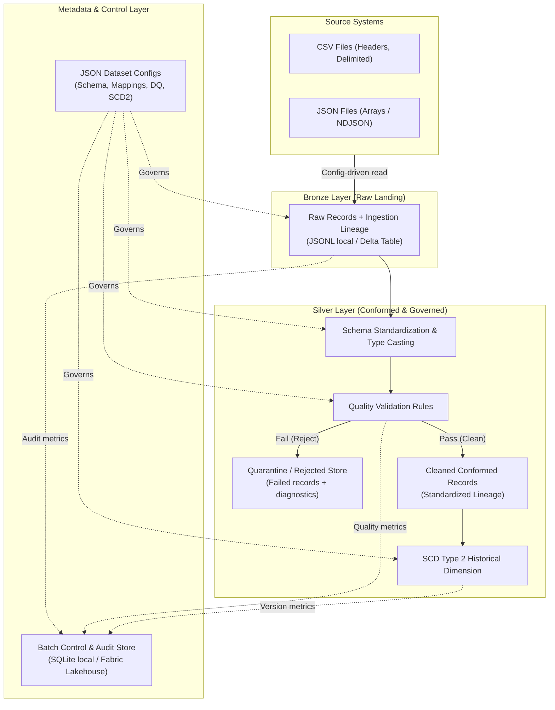

# System Architecture & Platform Integration

## 1. Architectural Mission

The **Metadata-Driven Bronze–Silver Data Engineering Accelerator** provides a modular, metadata-driven architecture designed to ingest raw tabular sources into a Bronze layer, standardize and validate them into a conformed Silver layer, manage historical dimension versioning via SCD Type 2, and maintain rigorous lineage, batch tracking, and auditability.

---

## 2. Multi-Layer Medallion Architecture

---

## 3. Implemented vs Planned Architectural Capabilities

| Architectural Layer | Local Prototype Implementation | Target Production State (Microsoft Fabric) | Status |
|---|---|---|---|
| **Configuration** | JSON files under `config/`, loaded & validated via `accelerator.contracts` | Fabric Git integration or Workspace Config Lakehouse | **Implemented & Tested** |
| **Ingestion** | `accelerator.bronze_ingestion.py` (CSV / JSON readers) | PySpark / Fabric Data Factory Copy Activity | **Implemented & Tested** |
| **Bronze Storage** | Local JSON Lines (`data/bronze/*.jsonl`) | Fabric OneLake Delta Lake (`abfss://.../Tables/bronze_*`) | Implemented locally; Fabric adapter planned |
| **Batch Control** | Local SQLite database (`data/metadata/ingestion.db`) | Fabric Lakehouse Table / SQL Analytics Endpoint | Implemented locally; Fabric adapter planned |
| **Silver Standardization** | Contract defined in `accelerator.contracts.SilverTransformerProtocol` | PySpark / Python transformation pipeline in Fabric Notebooks | Contract ready; Phase 1 target |
| **Data Quality & Quarantine** | Contract defined in `accelerator.contracts.QualityValidatorProtocol` | Great Expectations / native PySpark validation with quarantine Delta table | Contract ready; Phase 1 target |
| **SCD Type 2 Dimension** | Contract defined in `accelerator.contracts.Scd2ProcessorProtocol` | Delta Lake `MERGE INTO` or PySpark SCD2 processor | Contract ready; Phase 1 target |
| **Orchestration** | CLI Runner (`scripts/run_bronze_ingestion.py`) | Fabric Data Pipelines / Airflow / CLI Orchestrator | CLI runner implemented; Orchestrator Phase 1 target |

---

## 4. Microsoft Fabric Integration Strategy

A core requirement of the assessment is establishing a realistic, verifiable Microsoft Fabric integration path.

### 4.1 Architecture Decoupling Principle
The accelerator core is strictly **platform-independent Python**. Storage, batch tracking, and file I/O are decoupled behind abstract interfaces:
- `SourceReaderProtocol`: Reads from local filesystem or OneLake storage.
- `BronzeStoreProtocol`: Implemented as `LocalBronzeStore` locally, swappable for `FabricDeltaBronzeStore` on Fabric.
- `BatchTrackerProtocol`: Implemented as SQLite `BatchTracker` locally, swappable for a Fabric Lakehouse Delta table or Azure SQL database.

### 4.2 Fabric Adaptation Mapping

| Local Prototype Concept | Microsoft Fabric Equivalent | Migration Path / Implementation Mechanism |
|---|---|---|
| `data/fixtures/` | OneLake Files (`abfss://.../Files/raw/`) | Raw files landed via OneLake shortcuts or Fabric Data Factory copy activities. |
| `LocalBronzeStore` (`.jsonl`) | Fabric Lakehouse Delta Tables (`Tables/bronze_raw`) | Replace file writer with `records.write.format("delta").mode("append").saveAsTable("bronze_...")` in a Fabric Notebook. |
| `LocalSilverStore` (`.jsonl`) | Fabric Lakehouse Delta Tables (`Tables/silver_conformed`) | Save conformed records to managed Delta tables with partitioning by ingestion date. |
| SQLite `batch_control` | Fabric Lakehouse Table / Fabric Warehouse | Store audit records in a dedicated `metadata.batch_control` Delta table queryable via the Lakehouse SQL Analytics Endpoint. |
| CLI Runner | Fabric Notebook / Fabric Data Pipeline | Wrap pipeline invocation inside a Fabric PySpark Notebook parameterized by the JSON dataset configuration path. |

### 4.3 Realistic Assessment Disclaimer
The current local prototype runs entirely on standard Python 3.12 without external cloud dependencies. Fabric integration is designed at the contract level and does not claim to run live in a Fabric cloud tenant during local testing.
