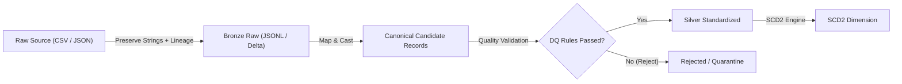

# Canonical Schemas and Normalization Contracts

## 1. Purpose and Philosophy

The accelerator employs a **metadata-driven canonical schema strategy**. The goal is to decouple raw source schemas from downstream analytical and dimension models, allowing disparate source formats and column naming conventions to map into standardized, validated Silver datasets without writing custom pipeline code for each source.

---

## 2. Multi-Layer Record Contracts



### 2.1 Bronze Record Contract
Bronze represents the immutable, raw landing zone:
- **Field Preservation:** All source column names and values are preserved exactly as read.
- **No Type Coercion:** Values are kept as strings (e.g., postal codes with leading zeros, dates with source formatting, floating-point representations) to avoid silent data truncation.
- **Mandatory Ingestion Lineage:** Every record is enriched with technical ingestion metadata:
  - `_ingestion_source_name` (`string`): Logical identifier of the source system.
  - `_ingestion_batch_id` (`string` / UUID): Unique identifier of the ingestion run.
  - `_ingestion_timestamp` (`string` / ISO-8601 UTC): Exact timestamp when the record was ingested into Bronze.

### 2.2 Silver Record Contract
Silver represents cleaned, standardized, and conformed entity data:
- **Canonical Naming:** Normalized lower_snake_case column names.
- **Typed Values:** Coerced to strong canonical types (`string`, `integer`, `float`, `decimal`, `boolean`, `date`, `timestamp`).
- **Standard Silver Lineage:**
  - `_silver_batch_id` (`string` / UUID): Identifies the Silver processing execution.
  - `_silver_processed_at` (`string` / ISO-8601 UTC): Timestamp of Silver standardization (deterministic per batch).
  - `_record_hash` (`string` / SHA-256): Deterministic hash of conformed canonical business fields (keys sorted alphabetically, JSON serialized with strict separators, excluding technical `_` lineage fields). Used for change detection and SCD2 version evaluation.

### 2.3 Slowly Changing Dimension (SCD Type 2) Contract
For dimensions tracking historical changes over time:
- **Business Key:** One or more natural keys identifying the entity across time (e.g., `customer_id`).
- **Surrogate Key:** `_scd_key` (`string` / UUID or deterministic hash of business key + effective date) uniquely identifying the row version.
- **Effective Date Range:**
  - `_effective_from` (`string` / ISO-8601 UTC): Ingestion/batch timestamp when this version became active.
  - `_effective_to` (`string` / ISO-8601 UTC): Timestamp when this version was superseded (or `NULL` / `9999-12-31T23:59:59Z` if currently active).
- **Current Flag:**
  - `_is_current` (`boolean`): `true` if active record; `false` if historical version.

### 2.4 Rejected / Quarantine Record Contract
Records that fail data quality validation rules with severity `REJECT` are never silently dropped; they are diverted to a quarantine store:
- `_rejection_batch_id` (`string` / UUID): Batch ID during which rejection occurred.
- `_rejected_at` (`string` / ISO-8601 UTC): Rejection timestamp.
- `_rejection_reason` (`string`): Human-readable failure description.
- `_failed_rule` (`string`): Name of the violated quality rule.
- `_raw_record` (`dict` / JSON): The complete original record as ingested in Bronze, enabling debugging, reprocessing, or audit inspection.

---

## 3. Canonical Field Type System

The framework defines an explicit, entity-agnostic type system in `accelerator.contracts.FieldType`:

| Canonical Type | Target Python / JSON Type | Casting & Formatting Rule |
|---|---|---|
| `string` | `str` | Stripped of leading/trailing whitespace if string transform configured; empty strings mapped to `None` if nullable. |
| `integer` | `int` | Parsed as integer. Non-numeric or fractional strings trigger validation failure. |
| `float` | `float` | Standard IEEE 754 floating point. |
| `decimal` | `str` or `Decimal` | Exact precision numeric string representation. |
| `boolean` | `bool` | Case-insensitive mapping: `true`, `1`, `t`, `yes` $\to$ `True`; `false`, `0`, `f`, `no` $\to$ `False`. |
| `date` | `str` (`YYYY-MM-DD`) | Parsed via configured format string; standardized to ISO date string. |
| `timestamp` | `str` (ISO-8601 UTC) | Standardized to UTC ISO-8601 format (`YYYY-MM-DDTHH:MM:SS.ffffff+00:00`). |

---

## 4. Schema Mapping & Evolution Policies

Configurations declare explicit mappings from source fields to canonical schema fields:

```json
{
  "source_column": "postal_code",
  "target_column": "postal_code",
  "transform": "trim",
  "default_value": null
}
```

### 4.1 Extra Columns Policy (`ExtraColumnsPolicy`)
When a source file contains columns not declared in the canonical schema:
- `ignore` (Default): Extra columns are discarded during Silver transformation. They remain safely preserved in Bronze raw data.
- `fail`: The pipeline rejects the entire batch if unexpected columns appear, protecting strict schemas.
- `preserve`: Extra columns are retained under a dedicated `_unmapped_attributes` object.

### 4.2 Missing Columns Policy (`MissingColumnsPolicy`)
When a canonical column is missing from the raw source file:
- `null` (Default): If the column is marked `"nullable": true`, it is populated with `null`/`None`. If `"nullable": false`, the record fails validation.
- `fail`: The batch is halted immediately upon configuration validation or schema mapping.

### 4.3 Data Quality Validation Rules (`QualityRule`)
Quality checks are declared in configuration and executed prior to landing records in Silver:
- `not_null`: Ensures specified columns contain non-null and non-empty values.
- `unique`: Verifies uniqueness of primary/business keys within the batch.
- `regex`: Validates pattern compliance (e.g., postal code format `^\d{5}$`).
- `range`: Verifies numeric or date bounds (`min`, `max`).

Severities:
- `warn`: Record proceeds to Silver; warning logged in audit metrics.
- `reject`: Record diverted to quarantine store; valid records in the batch continue processing.
- `critical`: Aborts batch execution immediately.
