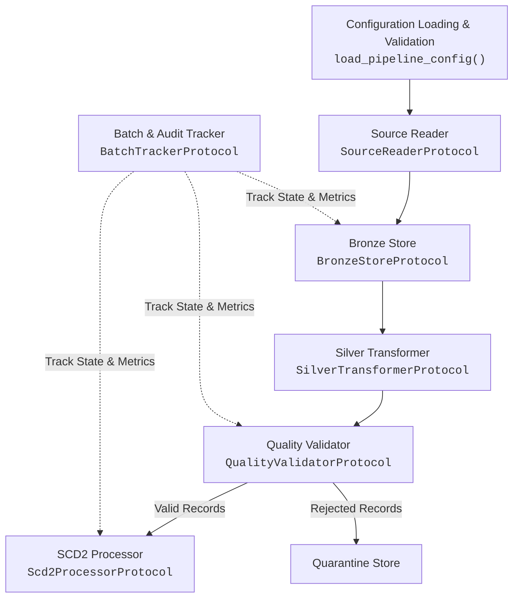

# Component Interfaces and Integration Contracts

## 1. Overview

This document specifies the exact component boundaries and Python interface contracts for the Metadata-Driven Bronze–Silver Data Engineering Accelerator. All components are defined as typed Python Protocols in `src/accelerator/contracts.py`.

---

## 2. Component Boundaries Matrix

| Component | Protocol / Function | Primary Owner | Phase Status |
|---|---|---|---|
| **Configuration Engine** | `load_pipeline_config()` | Framework Architect (T1) | **Implemented & Tested** |
| **Source Reader** | `SourceReaderProtocol` | Ingestion Architect (T2) | Implemented for CSV & JSON |
| **Bronze Store** | `BronzeStoreProtocol` | Ingestion Architect (T2) | Implemented (`LocalBronzeStore`) |
| **Silver Transformer** | `SilverTransformerProtocol` (`SilverTransformer`) | Silver Architect (T3) | **Implemented & Tested (Phase 3)** |
| **Quality Validator** | `QualityValidatorProtocol` | Silver Architect (T3) | Contract Defined; Phase 1 target |
| **SCD2 Processor** | `Scd2ProcessorProtocol` | Silver Architect (T3) | Contract Defined; Phase 1 target |
| **Batch Tracker** | `BatchTrackerProtocol` | Ingestion Architect (T2) | Implemented for SQLite |
| **Orchestrator** | `PipelineOrchestrator` | Framework Architect (T1) | Contract Defined; Phase 1 target |

---

## 3. Interface Specifications

### 3.1 Configuration Loading and Semantic Validation
- **Module:** `accelerator.contracts`
- **Function:** `load_pipeline_config(config_path: str | Path) -> PipelineConfig`
- **Inputs:** Absolute or relative path to a JSON pipeline configuration file.
- **Outputs:** Fully resolved, immutable `PipelineConfig` instance containing `SourceConfig` settings and optional `SilverConfig` specifications.
- **Exceptions:**
  - `ValueError`: Raised when the file does not exist, JSON is malformed, required fields are absent, data types are unsupported, column mappings reference undefined columns, or SCD2 is enabled without valid business keys.
- **Semantic Guarantees:** All relative filesystem paths (`input_path`, `bronze_path`, `silver_path`, `metadata_store`) are resolved relative to the directory containing the configuration file.

### 3.2 Source Reader
- **Protocol:** `SourceReaderProtocol`
- **Method:** `read(config: PipelineConfig) -> Iterable[dict[str, Any]]`
- **Inputs:** `PipelineConfig` with `format`, `input_path`, `delimiter`, and `encoding`.
- **Outputs:** An iterable stream or generator of record dictionaries where all values remain in raw representation (strings for CSV, native types for JSON).
- **Exceptions:**
  - `FileNotFoundError`: If input file is missing at runtime.
  - `ValueError`: If file contents cannot be parsed according to the specified format.

### 3.3 Bronze Landing Store
- **Protocol:** `BronzeStoreProtocol`
- **Method:** `append(destination: Path, records: Iterable[dict[str, Any]]) -> int`
- **Inputs:** Destination `Path` and an iterable of records enriched with `_ingestion_source_name`, `_ingestion_batch_id`, and `_ingestion_timestamp`.
- **Outputs:** Total integer count of records written.
- **Implementations:**
  - `LocalBronzeStore` (Implemented): Appends UTF-8 JSON Lines to local filesystem.
  - `FabricDeltaBronzeStore` (Planned Phase 2): Appends records to Microsoft Fabric Lakehouse OneLake Delta table.

### 3.4 Silver Transformer
- **Module:** `accelerator.silver_transformations`
- **Class:** `SilverTransformer` (implements `SilverTransformerProtocol`)
- **Method:** `transform(records: Iterable[dict[str, Any]], silver_config: SilverConfig, batch_id: str) -> list[dict[str, Any]]`
- **Inputs:** Raw Bronze records, `SilverConfig` (mappings, type definitions, extra/missing column policies), and current `batch_id`.
- **Outputs:** Conformed records formatted to canonical names, types, and enriched with `_silver_batch_id`, `_silver_processed_at`, and `_record_hash`.
- **Mapping & Type Casting:**
  - Evaluates `ColumnMapping` source-to-target names with string transforms (`trim`, `upper`, `lower`).
  - Converts canonical fields to `FieldType` (`string`, `integer`, `float`, `decimal`, `boolean`, `date`, `timestamp`).
  - Rejects truncation of non-integral floats to integer or booleans to numbers.
  - Preserves leading zeros on identifier strings (e.g., postal codes).
- **Missing & Extra Column Policies:**
  - Missing columns: `MissingColumnsPolicy.NULL` populates `None` (or configured default_value); `MissingColumnsPolicy.FAIL` raises error.
  - Extra columns: `ExtraColumnsPolicy.IGNORE` drops unmapped fields; `ExtraColumnsPolicy.FAIL` raises error; `ExtraColumnsPolicy.PRESERVE` retains unmapped fields under `_unmapped_attributes`.
- **Deterministic Hashing:** Calculates SHA-256 `_record_hash` over canonical business fields (excluding batch IDs and timestamps) with sorted keys.
- **Exceptions:**
  - `ValueError`: If required columns are missing under `fail` policy, unexpected columns appear under `fail` policy, unsupported transforms/types are specified, or values cannot be cast to declared types without silent corruption.

### 3.5 Quality Validator & Rejection Handler
- **Protocol:** `QualityValidatorProtocol`
- **Method:** `validate(records: list[dict[str, Any]], rules: list[QualityRule]) -> tuple[list[dict[str, Any]], list[dict[str, Any]], list[QualityCheckResult]]`
- **Inputs:** Transformed candidate records and list of `QualityRule` definitions.
- **Outputs:** Three-tuple:
  1. `valid_records`: Records passing all checks.
  2. `rejected_records`: Records failing `REJECT` severity rules, decorated with `_rejection_reason`, `_failed_rule`, `_rejected_at`, and `_raw_record`.
  3. `check_summaries`: List of `QualityCheckResult` objects for audit tracking.
- **Exceptions:**
  - `RuntimeError` or `ValueError`: If a rule with severity `CRITICAL` fails.

### 3.6 Slowly Changing Dimension Type 2 (SCD2) Processor
- **Protocol:** `Scd2ProcessorProtocol`
- **Method:** `apply_scd2(incoming_records: list[dict[str, Any]], target_path: Path, scd2_config: Scd2Config, batch_id: str) -> int`
- **Inputs:** Validated Silver records, destination dimension path, `Scd2Config` (business keys, tracking columns, metadata column names), and `batch_id`.
- **Outputs:** Count of affected records (new versions inserted + superseded versions closed).
- **Behavior:**
  1. Compares incoming records against existing active records (`_is_current == True`) on `business_keys`.
  2. If business key is new: Inserts with `_effective_from = now`, `_effective_to = NULL`, `_is_current = True`.
  3. If business key exists and tracking columns changed: Updates existing record with `_effective_to = now`, `_is_current = False`; inserts new record version with `_effective_from = now`, `_effective_to = NULL`, `_is_current = True`.
  4. If business key exists and tracking columns have NOT changed: No-op (or update non-tracked attributes if SCD1 attributes present).

### 3.7 Batch Tracking and Auditing
- **Protocol:** `BatchTrackerProtocol`
- **Methods:**
  - `start(source_name: str, input_path: str, format_: str, ingested_at: str) -> str`: Inserts record in `batch_control` with status `RUNNING`, returns UUID `batch_id`.
  - `finish(batch_id: str, status: BatchStatus, records_processed: int, finished_at: str) -> None`: Updates batch record with final status and metrics.
- **Lifecycle Statuses:** `PENDING`, `RUNNING`, `SUCCESS`, `PARTIAL_SUCCESS`, `FAILED`.
- **Rerun Semantics:**
  - Current local prototype writes new batch records on every run.
  - Phase 1 will implement idempotent batch reruns where existing batches can be safely rolled back or overwritten.
